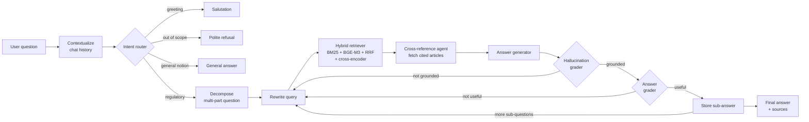

# BCT Regulatory Assistant — Agentic RAG for Tunisian Central Bank Regulation

> A question-answering assistant over the foreign-exchange regulation of the **Banque Centrale de Tunisie (BCT)**: it retrieves the exact articles, circulars and notices that answer a question, cites them, and checks its own answer for hallucinations before replying.


## Why this project

Bank staff answering regulatory questions have to search a ~60-document corpus (laws, decrees, circulars and *avis de change* from 1975 to 2024) where one rule often refers to another. A generic chatbot invents article numbers; this assistant only answers from retrieved text and shows its sources.

## Highlights

- **~90 % accuracy** on an internal benchmark of 80 regulatory questions (simple and multi-part).
- **Hybrid retrieval**: BM25 + dense embeddings (BAAI/bge-m3) fused with Reciprocal Rank Fusion, then re-ranked by a cross-encoder (bge-reranker-v2-m3).
- **Structure-aware chunking** that follows the legal hierarchy *Partie › Titre › Chapitre › Article* — 2,088 chunks, each carrying its breadcrumb and article reference.
- **Agentic control flow** with LangGraph: intent routing, query decomposition for multi-part questions, query rewriting, cross-reference resolution, hallucination and relevance grading with retries.
- **Resilient LLM layer**: round-robin over several API keys with automatic provider fallback.

## Architecture



**Ingestion**: PDFs are parsed with Docling (OCR for scanned pages), cleaned, split along the legal hierarchy, embedded and stored in ChromaDB with metadata (`source`, `theme`, `article_ref`, `chunk_type`…).

## Tech stack

| Layer | Tools |
|---|---|
| Orchestration | LangGraph, LangChain |
| Retrieval | ChromaDB, rank-bm25, sentence-transformers (BGE-M3), BGE reranker |
| Parsing | Docling, RapidOCR, pdfplumber |
| LLM | Groq / Gemini / OpenRouter (open-weight models), key rotation + fallback |
| UI | Streamlit |

## Project structure

```
config.py        models, paths, retrieval parameters
state.py         LangGraph state definition
retriever.py     hybrid retrieval (BM25 + dense + RRF + rerank)
decomposer.py    multi-part question detection and splitting
nodes.py         graph nodes (router, rewriter, retriever, graders, generator)
routers.py       conditional edges
evaluators.py    hallucination and answer graders (chain-of-thought JSON, fail-safe)
graph.py         graph assembly
pipeline.py      single entry point: ask_bct(question, history)
tools.py         LLM clients, key rotation, provider fallback
LOTPDF.py · test_docling.py · clean.py · chunk.py · emedding.py · BM25.py   ingestion pipeline
streamlit.py     chat interface
VERSION1/        first, non-agentic RAG prototype (kept for comparison)
```

## Getting started

```bash
git clone https://github.com/eya-dl/bct_reglementation.git
cd bct_reglementation
python -m venv .venv && source .venv/bin/activate   # Windows: .venv\Scripts\activate
pip install -r requirements.txt

# API keys (never committed)
cp .env.example .env    # then fill GROQ_API_KEY_1, GEMINI_API_KEY_1, ...

# Build the index (once)
python LOTPDF.py         # split the source PDF into 40-page parts -> pdf_chunks/
python test_docling.py   # parse each part to Markdown with Docling (+ OCR)
python clean.py          # clean the Markdown
python emedding.py       # hierarchical chunking + BGE-M3 embeddings -> ChromaDB
python BM25.py           # build the BM25 index

streamlit run streamlit.py
```

Programmatic use:

```python
from pipeline import ask_bct
result = ask_bct("Quelles sont les conditions d'ouverture d'un compte en devises ?", [])
print(result["final_answer"])
for s in result["sources"]:
    print(s["type"], s["number"], s["article"])
```

## Evaluation

- Benchmark of 80 questions written from the official *Recueil de la Réglementation des Changes* (Oct. 2024), each with its expected source: **~90–92 % correct answers**.
- Failure analysis drove most improvements: lost hierarchy context during parsing (157 → 81 unlabelled chunks), silent truncation of embeddings, permissive hallucination grader, duplicate sources after rank fusion.
- A RAGAS evaluation (faithfulness, answer relevancy, context precision/recall) on a 110-question set is in progress.

## Roadmap

- [ ] Finish the RAGAS evaluation and publish the scores
- [ ] Deduplicate chunks after RRF fusion before re-ranking
- [ ] Docker image for on-premise deployment

## Author

**Eya Dhambri** — AI engineering student at ENSI (Tunisia) · [LinkedIn](https://www.linkedin.com/in/eya-dhambri) · eya.dhambri@ensi-uma.tn
